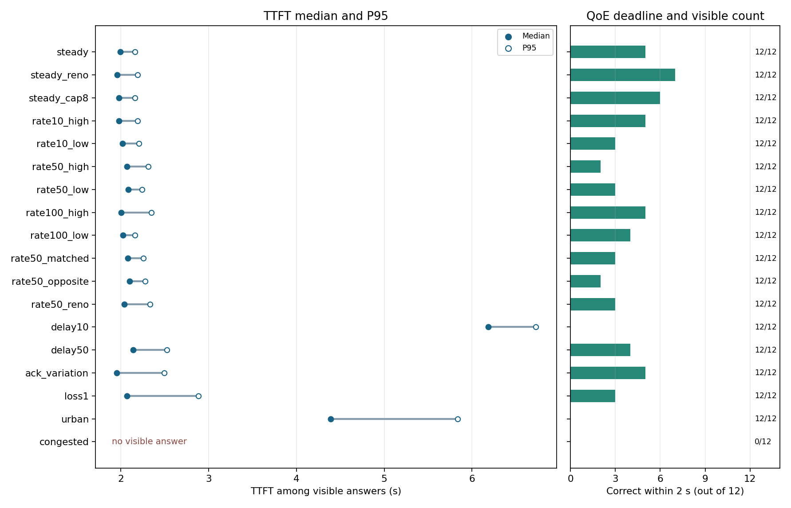
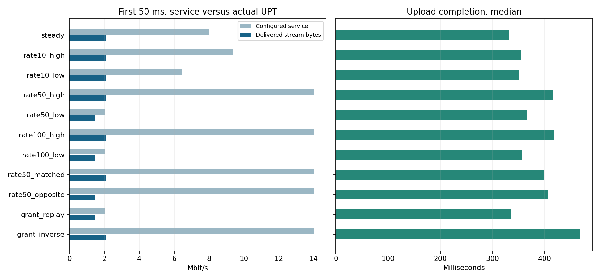
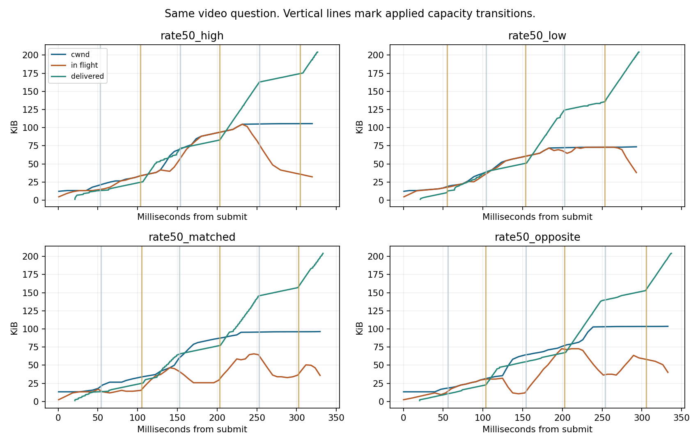
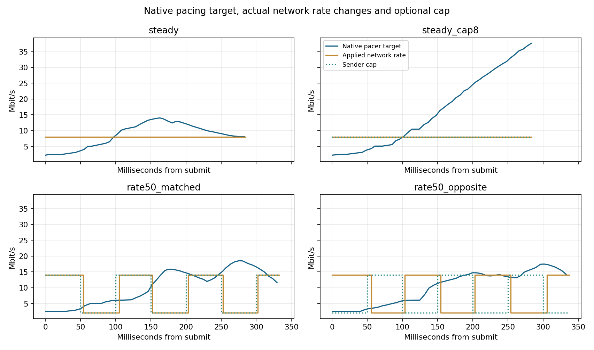

# QUIC 多模态推理的网络需求实验

本版完成 **336 轮正式试验**，主矩阵 216 轮，独立复验 120 轮。**324 轮收到可见回答，12 轮超时**，每轮均有双侧 PCAP 与双端 qlog。这个业务中，快速时延变化诱发的乱序造成了最大的 QoE 损失。等平均容量下，短时授权安排得当可以改善上传，但仍应与固定速率基线比较。[主矩阵验收](results/v2/validation.json) · [复验验收](results/v2/repeat/validation.json)

## 业务与测量路径

业务是四帧视频问答。对 StreamingBench 固定六个视频，每个视频取两道题。每题发送提问时刻之前的四张连续原生帧、问题和四个选项。二进制请求在同一条可靠 QUIC 双向 Stream 中上传，内容由 JSON 小头和四张原始 JPEG 组成。标签仅由评分器使用。服务器校验 JPEG 和整条请求的 SHA-256，随后在本地运行 MiniCPM-o 2.6 Q4_K_M 与 F16 视觉投影器，通过同一 Stream 返回模型真实产生的文本增量。后端 HTTP/SSE 仅在收端命名空间的回环接口使用。

所有端点位于同一台 WSL2 主机。业务流经过客户端 veth、中间路由器、服务器 veth。用开源 5G-MAG 6G-Testbed 固定提交的 NetworkEmulator 加载 HTB/netem 规则，以独立前向和反向出口控制数据和 ACK。使用原版 TrafficLogger 写 SQLite。外部场景驱动负责定时切换、执行推理和双侧抓包。模型常驻 RTX 3070，测量前用两道不重叠的题预热，每次推理设置 cache_prompt=false。每题每个条件新建一条 QUIC 连接，握手单列，QoE 计时从请求提交开始。问答仅需要一个选项字母，下行输出很小。

## 受控网络变化

| 对照 | 保持一致 | 改变的量 |
|---|---|---|
| 固定与波动速率 | 正向目标平均 8 Mbit/s，正反向基础时延各 20 ms | 固定 8，或在 14/2 Mbit/s 间切换，每档 10、50 或 100 ms。每种周期包含高档先和低档先 |
| 固定与波动时延 | 前向 8 Mbit/s，前向阶跃时延的配置均值 20 ms，反向 20 ms | 前向固定 20 ms，或在 5/35 ms 间按 10 或 50 ms 驻留切换。另试 FIFO 子队列及固定 5 ms 加 30 ms 时隙释放，用实际包号核对是否保序 |
| pacing 协同 | 路由器服务轨迹与请求相同 | 比较原生 pacer、按预定服务同相限速、反相限速。固定 8 Mbit/s 另加同速 cap 对照 |
| 网络侧授权 | 原生 CUBIC 和每 100 ms 的服务预算相同 | 根据同题此前固定链路的发送侧 PCAP，在每个 100 ms 对内给发送需求较高的 50 ms 档分配 14 Mbit/s，另一档 2 Mbit/s。反相对照交换两个档位 |
| 独立扰动与综合压力 | 同一组请求和模型 | 只改变反向 ACK 抖动、前向 1% 随机丢包，以及上游 5g_urban、congested |

动态条件在相同 8 Mbit/s、20 ms 的正向基础规则下建立连接，随后为请求设置首档。网络变化用 tc change 更新同一个 qdisc，记录每次提交时间。更新运行到上传完成或约 4 秒，后者保持最后一档。计划驻留时间与实际提交时间分别记录，HTB 速率档位表示软件仿真服务能力。FIFO 子队列复验使用同一目标波形。时隙释放是一种不同的时延分布，实际分布以双侧抓包为准。

## 传输算法与观察方法

aioquic 1.2.0 的实验连接协商 QUIC v1、TLS 1.3 和本地应用 ALPN testbed-quic/1。主算法为 CUBIC，另测 Reno。发送预算受拥塞窗口与在途字节约束，原生 token-bucket pacer 的目标由 cwnd/SRTT 给出。判丢依据包括包号阈值与时间阈值。对照中的服务 cap 叠加于原生 pacer，仍受窗口、ACK 和重传限制，允许两个数据报的令牌积累。发送端看到的是实验预先给定的网络计划，路由规则的实际提交时间存在毫秒级误差。网络侧授权复验用上一轮发送包时序作先验，实际 QUIC 仍可改变发送节奏。它体现可知需求下的授权时序效果。

收集端点 qlog、双侧 PCAP、Testbed SQLite 和逐轮状态。端点状态记录 cwnd、在途字节、平滑 RTT、pacer 的包时间、等待检查、定时器晚醒和 PTO。收发 qlog 用相同 1-RTT 包号核对误判丢包。用服务器按序可交付的唯一应用字节计算 10、50、100、200 ms UPT，并另报滑窗峰值。表中的短时服务率取已执行的网络档位对时间积分，和业务 UPT 分开。流控帧数用于检查接收流控干扰。

QoE 包括上传完成时延、服务器首个可见增量耗时、首增量回程、客户端 TTFT、末个可见增量 TTLT 和完整回复时间。准确率与截止内正确均以全部发起请求为分母。超时保留且 TTFT 缺失。时延分位数基于收到可见回复的请求，和答复覆盖率同时报告。配对差值在同一道题、相同请求哈希上计算。

## 主实验结果

正式集每个配置 12 道题，每题负载 **190–391 kB**。固定链路的服务器首个可见增量耗时中位数为 **1.63 s**，上传中位数 **332 ms**，首增量回程约 **20.5 ms**。模型推理在一般网络条件下是 TTFT 的最大组成，前向时延快速变化时上传变成主导项。

| 网络与算法 | 上传中位数 | TTFT 中位数 / P95 | 有可见回复 | 2 秒内正确 |
|---|---:|---:|---:|---:|
| 固定 8 Mbit/s，CUBIC | 332 ms | 1.99 / 2.16 s | 12/12 | 5/12 |
| 固定 8 Mbit/s，Reno | 330 ms | 1.96 / 2.19 s | 12/12 | 7/12 |
| 14/2 Mbit/s、每档 10 ms，高档先 | 354 ms | 1.98 / 2.19 s | 12/12 | 5/12 |
| 14/2 Mbit/s、每档 50 ms，高档先 | 416 ms | 2.07 / 2.31 s | 12/12 | 2/12 |
| 14/2 Mbit/s、每档 50 ms，低档先 | 366 ms | 2.09 / 2.24 s | 12/12 | 3/12 |
| 14/2 Mbit/s、每档 100 ms，高档先 | 418 ms | 2.01 / 2.35 s | 12/12 | 5/12 |
| 正向 5/35 ms、每档 10 ms | 4,452 ms | 6.18 / 6.73 s | 12/12 | 0/12 |
| 正向 5/35 ms、每档 50 ms | 457 ms | 2.14 / 2.53 s | 12/12 | 4/12 |
| 仅反向 ACK 抖动 | 323 ms | 1.95 / 2.50 s | 12/12 | 5/12 |
| 前向随机丢包 1% | 410 ms | 2.07 / 2.88 s | 12/12 | 3/12 |
| 上游 5g_urban | 2,642 ms | 4.39 / 5.83 s | 12/12 | 0/12 |
| 上游 congested | — | — | 0/12 | 0/12 |

固定链路答对 **9/12**。有可见回复的 204 轮里，每道题的输出字母跨配置一致。固定链路 TTLT 中位数为 **1.99 s**，完整回复中位数 **2.01 s**。8 秒请求截止使 congested 的 12 轮均无可见回答，TTFT 保持缺失。传输的主要影响体现为迟到或不可用。两种时延切换中的 10 ms 档位，对全部 12 个配对的 TTFT 中位增量为 **4.20 s**。发送端有效上传期间的 cwnd 中位数由 **99.1 kB 降为 3.45 kB**，窗口低余量采样比例由 **45.4% 升到 93.5%**。前向队列丢包中位数为 **0**，发送端判丢且在对端实到的 1-RTT 包中位数是 **128.5**。这里的 QoE 退化与乱序触发误判、窗口收缩以及 pacer 跟着降速相符。10 ms 时延切换的实际提交滞后 P95 的逐轮中位数为 **4.42 ms**。

## 速率匹配与短时 UPT

在 50 ms 高档先与低档先对照里，首 50 ms 的网络服务中位数分别为 **14 和 2 Mbit/s**，按序应用 UPT 只分别为 **2.11 和 1.49 Mbit/s**。高档先的上传反而在 11/12 对里更慢，配对中位差 **+48.9 ms**。固定 8 Mbit/s 时首 50 ms 的实际 UPT 也约 **2.11 Mbit/s**。因此单看启动时的高档速率或单看首 50 ms 的 UPT，均无法判断整个上传完成时间。高档是否落在有待发字节、且已有 ACK 释放窗口的时间段更重要。

| 发送端策略对照 | 上传配对中位差 | TTFT 配对中位差 | 上传更快的题 |
|---|---:|---:|---:|
| 固定 8 上的同速 cap，相对原生 CUBIC | −2.9 ms | +1.6 ms | 11/12 |
| 50 ms 同相 cap，相对原生 CUBIC | −10.7 ms | −0.1 ms | 10/12 |
| 50 ms 同相 cap，相对反相 cap | −5.5 ms | −6.0 ms | 10/12 |

固定 8 Mbit/s 上加同速 cap 后，匹配到达包的单向 P95 的逐轮中位数由 **85.1 降到 26.2 ms**，但 QoE 的 TTFT 没有随之下降。同相 cap 在高档的整形前实际发送 IP 速率中位数为 **8.77 Mbit/s**，反相 cap 为 **2.41 Mbit/s**，有可测的容量匹配效果。真实体验改善小于传输改善，尤其本次答题的模型耗时约 1.6 秒。这个比较使用同一套网络档位，相位对照单独说明发送侧 cap 的作用。

首 50 ms 内，14 Mbit/s 的名义服务预算约 **87.5 kB**，应用按序收到了约 **13.2 kB**。这项对照包含正向传播时间和 QUIC 启动反馈，二者的比值表示该截止窗口内兑现为应用交付的比例。滑动窗口峰值和首窗口累计交付分别提供了短突发能力和业务启动体验的观察，报告保留两种指标。

反相 cap 的 50 ms 滑窗峰值 UPT 中位数是 **12.42 Mbit/s**，略高于同相 cap 的 **12.03 Mbit/s**，但整体上传更慢。流中间一次较高的交付峰值可包含先前积压数据的集中交付。描述请求完成和体验时，需要把峰值与首窗口交付、完整上传时间放在一起。

### 独立复验与网络侧授权

| 同题配对 | 上传中位差 | TTFT 中位差 | 上传 / TTFT 更快的题 |
|---|---:|---:|---:|
| 50 ms 高档先，相对低档先 | +46.1 ms | +69.0 ms | 0/12 · 0/12 |
| 同相发送 cap，相对原生 pacing | −17.6 ms | +1.8 ms | 11/12 · 6/12 |
| 同相发送 cap，相对反相 cap | −3.3 ms | +24.1 ms | 9/12 · 6/12 |
| 网络授权匹配同题先前发送需求，相对反向授权 | **−130.3 ms** | **−150.3 ms** | **12/12 · 11/12** |
| 网络授权匹配先前需求，相对固定 8 Mbit/s | +7.0 ms | +15.4 ms | 3/12 · 5/12 |

网络侧授权复验每个 100 ms 内都有一个 14 和一个 2 Mbit/s 档，顺序由同题固定链路的历史 PCAP 选择。相对反向授权，2 秒内正确从 **1/12 提升到 5/12**。同一复验中的固定 8 Mbit/s 对照为 **6/12**。授权匹配使用了可知的历史需求，量化的是同预算的时序收益，未实现在线预测或无线调度。它的首 50 ms UPT **1.49 Mbit/s**，低于反向授权的 **2.11 Mbit/s**，但整笔请求更快。只看首个窗口的 UPT 会给出相反排序。

FIFO 子队列负对照保留同样的 5/35 ms 时延变化。在本内核的这组 qdisc 配置上，它未消除真实乱序。接收端乱序 STREAM 包中位数为 **126**，未加 FIFO 子队列是 **120**，同题 TTFT 配对差 **+66.9 ms**。因此单凭 qdisc 的名称无法判断有序交付。

固定 5 ms 加 30 ms 时隙释放的条件经包号验证，**12/12 轮的乱序 STREAM 包和误判丢包均为 0**。相对 10 ms 时延阶跃，单向包时延 P95 的逐轮中位数反而从 **35.1 升至 89.8 ms**，但上传从 **4,380 降至 451 ms**，TTFT 从 **6.15 降至 2.16 s**。相对固定 8 Mbit/s，它仍让每道题上传变慢，配对中位差 **+118.6 ms**，TTFT **+188.1 ms**。两种波形的实际分布不同。这组结果说明评估稳时延时，既要看绝对等待，也要看包序与拥塞反馈是否被破坏。

## 从试验导出的网络需求

| 优先关注 | 可验证的网络指标 | 与业务的关系 |
|---|---|---|
| 限制时延突变造成的乱序 | 同一流的前向单向时延 P50/P95/P99、相邻包时延跳变量、乱序比例和包号深度。用双端序号区分实际丢失与误判 | 这一组在零前向队列丢包下出现大量误判，压缩 cwnd 和 pacing。单给平均时延或平均速率无法暴露这类风险 |
| 提供有截止时间的上行服务预算 | 报告 50/100 ms 内可提供的有效字节、最长低服务间隔和档位实际兑现时间。与请求大小、RTT、窗口余量同报 | 平均 8 Mbit/s 下，50 ms 高低档的先后已经改变上传时间。高峰必须与发送端有待发字节及拥塞信用的时段重叠，才更可能转成应用交付 |
| 将 pacing 匹配作为排队控制指标 | 比较整形前 IP 发送与整形后的服务速率、排队尾部和上传完成时间。联合评估发端 cap 和网络分配 | 同速 cap 显著降低单包排队尾部，同题 TTFT 收益小。短时授权可比较“同预算、不同顺序”，避免用增加总带宽代替协同 |
| 把反向反馈和真实丢包分开监测 | ACK 到达间隔尾部、前反向丢包、ACK 与 RTT 样本、PTO、有效交付率 | 本业务上行远大于下行，回程在上传期主要承载 ACK。仅反向抖动时中位数变化小，但尾部需要监测。真实丢包与时延诱发乱序需要分别诊断 |
| 用业务预算验收 | 首字可见、上传完成、答复可用率及截止内正确率。单独记录模型服务时间和连接建立 | 同样的上传改善在约 1.6 秒模型负载上只占较小比例。上传占主导或任务有更紧的截止时，服务时序才更容易反映到 QoE |

**短时 UPT 有诊断价值，当前控制器没有独立的短时容量输入。** 实测版本的 CUBIC、Reno 和原生 pacer 消费 ACK、RTT 和丢包反馈，能间接感知交付变化。它们的输入里没有路由器未来 10/50/100 ms 的服务预算。应用 UPT 描述当下实际交付，可用于判断启动阶段是否用上了高档。用于调度或跨层协同时，应区分可兑现的未来服务量与过去测到的 UPT，同时暴露有效时间和持续长度。短高档的收益需要考虑 cwnd、在途量和 ACK 节奏。

这些指标是本实验支持的验收方向。绝对阈值应按业务字节量和剩余时限换算。例如 250 kB 在 300 ms 内全部到达，单看有效字节已需要 **6.67 Mbit/s**；要从提交起算，还要给传播、启动窗口与重传留出预算。

## 数据质量与范围

首轮审计发现少量重传 FIN 会使应用层收到重复结束事件，因而重复启动推理。服务端增加同一 Stream 的一次性触发保护，并完整重跑 delay50 和 5g_urban 的各 12 道题。初次这两个配置的 24 条运行保留为本地诊断数据，正式表采用修复后的运行。所有超时照常计入正式分母。

正式样本是六个视频的固定子集，复验用相同题目并重新随机化配置执行顺序。每格 12 条请求的 P95 用于描述样本尾部。结果适用于此版本的 aioquic、单机 WSL2 和这组有序或乱序的受控软件路径。握手单列，视频采集与 JPEG 编码在测量前完成。单字母输出使实验主要检验多模态上行，无法估计长篇生成下行的 stall 或音视频会话 QoE。

## 参考

- [5G-MAG 6G-Testbed](https://github.com/5G-MAG/6G-Testbed/tree/7231ae8e5670b67564cf28d397c2820d9403ecdc)
- [aioquic 1.2.0 恢复和 pacer 源码](https://github.com/aiortc/aioquic/blob/1.2.0/src/aioquic/quic/recovery.py)
- [RFC 9002 拥塞控制与 pacing](https://www.rfc-editor.org/rfc/rfc9002.html#section-7.7)
- [netem 乱序和 FIFO 配置](https://man7.org/linux/man-pages/man8/tc-netem.8.html#EXAMPLES)
- [MiniCPM-o 2.6 模型](https://huggingface.co/openbmb/MiniCPM-o-2_6-gguf/tree/565cac3bb01ac51e985fff9f5d7a52322b826c23)
- [StreamingBench](https://github.com/THUNLP-MT/StreamingBench)

## 数据与复现

- [逐题 QoE 与传输统计](results/v2/requests.csv) · [主矩阵汇总](results/v2/profiles.csv) · [复验汇总](results/v2/repeat/profiles.csv) · [同题配对](results/v2/paired.csv)
- [主矩阵逐轮交通时序](results/v2/traffic_trace.jsonl.gz) · [复验逐轮交通时序](results/v2/repeat/traffic_trace.jsonl.gz) · [模型文件哈希](results/v2/model-provenance.json)
- [复现步骤](v2/README.md) · [带 SQLite、代表性双端 qlog 和双侧 PCAP 的公开归档](https://github.com/qinyishcn/quic-testbed-lab/releases/tag/v2.0.0)
- [公开归档 SHA-256](results/v2/archive.json)
