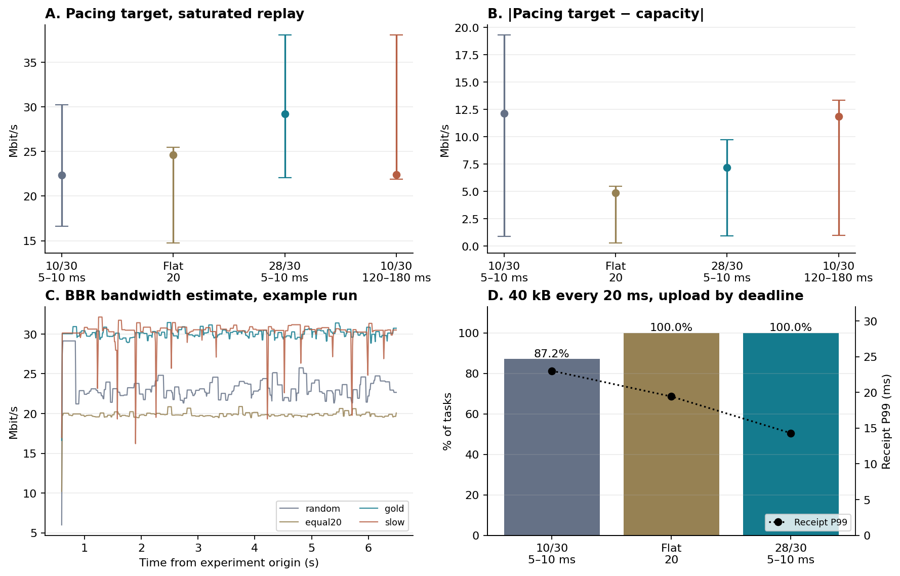
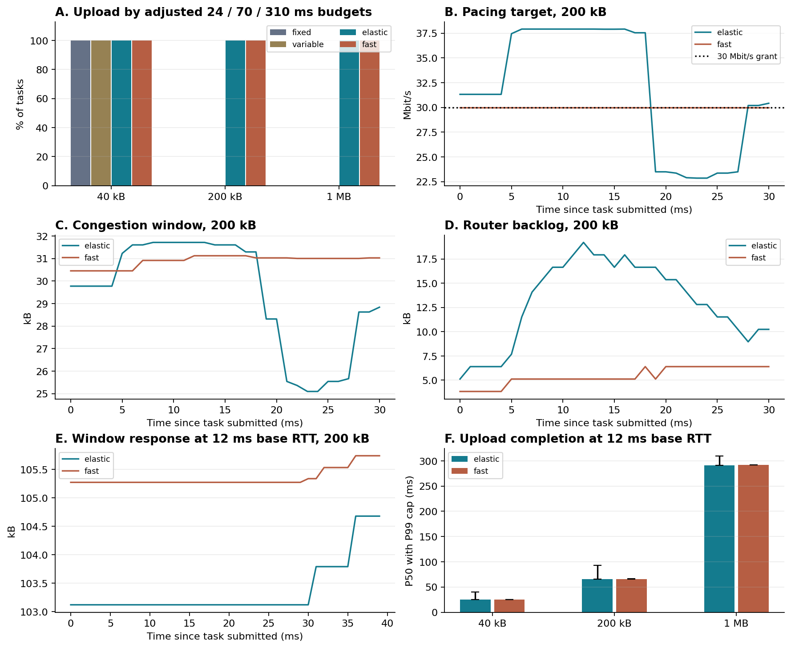
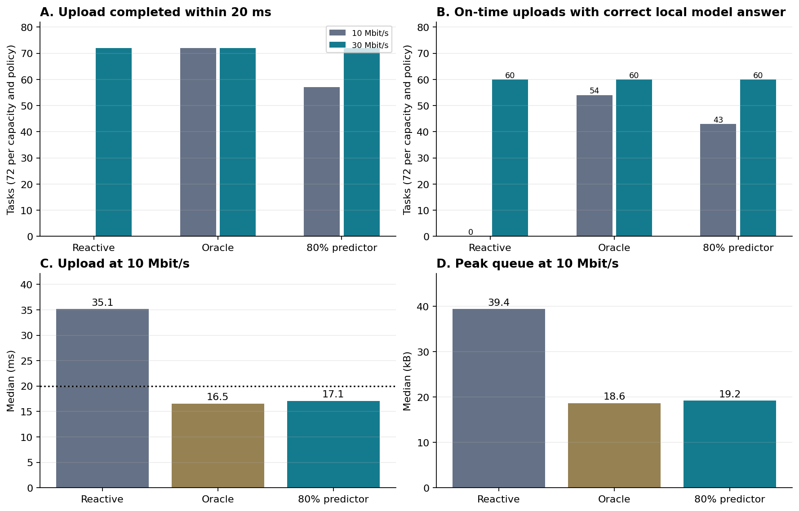
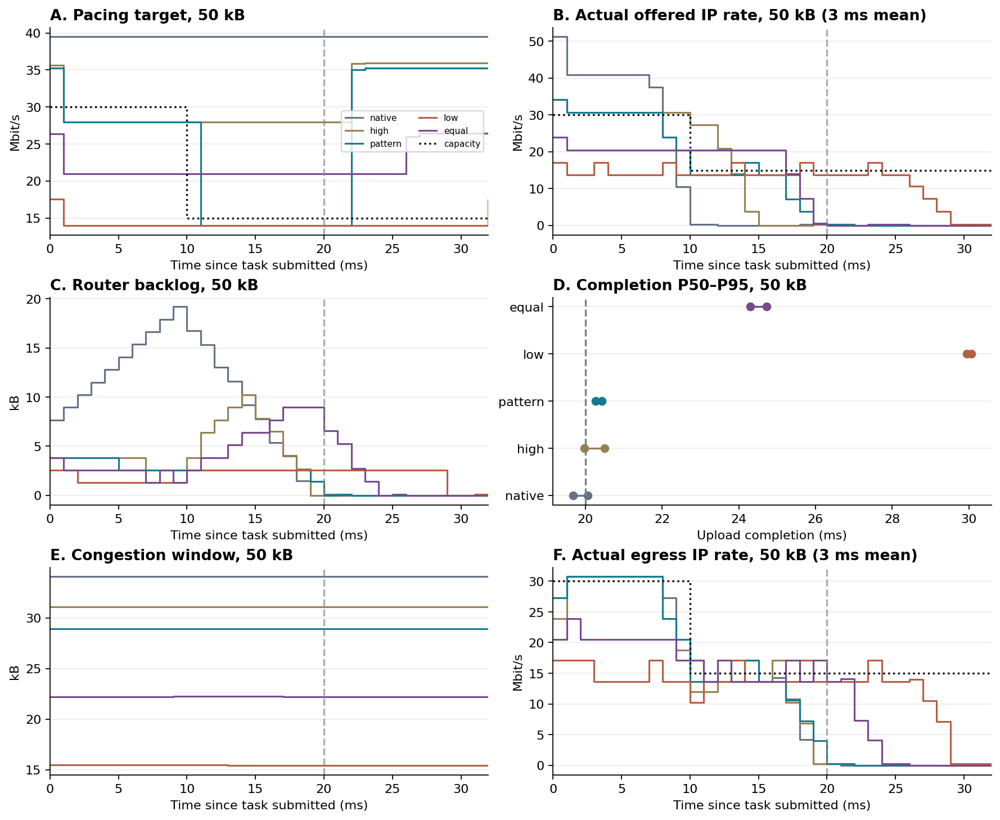

# 黄金管道能让 QUIC BBR 更好地完成 AI 突发任务吗？

本版把「黄金管道」拆成四个可以分别验证的动作。A1 稳住服务容量，B1 按任务分配资源，C1 在上传前选数据档位，D1 在同一突发内按容量曲线发包。每组都有常规基线和单独对照。配置中的「空口」在本机表示可控的前向 IP 服务能力。

正式结果包含 **21 个配置 × 3 轮，12,294 次任务发送**，包括 C1 的重试。所有发送最终完整交付，表中未达标指超出对应预算。正式轮次内，路由中继未丢包，出队定时误差逐轮 P99 最大 **0.36 ms**，任务提交误差逐轮 P99 最大 **0.39 ms**。初轮发现本地 CPU 推理进程与网络实验有重叠，剔除受影响轮次并重跑该整批。模型成绩使用另外独立完成的本地推理。[运行环境](results/v3/environment.json) · [逐轮指标](results/v3/runs.json)

## 实验怎么读

**传输**使用固定提交的 picoquic 原生 **BBRv1**，沿用 6G-Testbed 的隔离命名空间、虚拟网卡和双向 `netem`。picoquic 实测读出 BBR 带宽估计、pacing 目标、cwnd、在途字节、RTT，并用路由器实际入队和出队记录测包速率与队列。原生 BBR 按 ACK 估计带宽，并主动试探。目标速率和实际出包是两个量，尤其在应用短时无包可发时。常规基础 RTT 配置为 2 ms，B1 另做 12 ms。所有配置按随机顺序串行运行。没有注入 ACK 拥塞或前向随机丢包。[picoquic BBRv1 源码](https://github.com/private-octopus/picoquic/blob/37bb5d28aaea417649a6d4facc15f54de7d55829/picoquic/bbr1.c) · [Testbed](https://github.com/5G-MAG/6G-Testbed)

**任务和时限**以十进制 kB 计。A1/B1/D1 用精确大小的可靠 QUIC Stream 突发隔离传输机制。C1 用 12 道真实视频问答，每题四张过去帧重编码为两个档位，两档均用本地 MiniCPM-o 2.6 真跑。上传时间从应用提交到收端收到完整请求，20 ms 为上传预算。收端另回一个字节测传输回执 P99。模型真实首字独立计量，A1 的 50 次/秒级联与推理排队未做联测。B1 中 200 ms 是目标体验预算，实验以明确可行的上传预算比较资源策略。频谱利用率、实网阴影和预测准确率均未在无线设备上测量。[复现和证据口径](v3/README.md)

## A1｜稳定高容量能让 BBR 收敛得更好吗？

40 kB 每 20 ms 提交一次，连续 8 秒。比较普通 10/30 Mbit/s（每档 5–10 ms，均值约 20）、等均值恒定 20 和黄金 28/30（均值约 29）。每组另把任务间隔压至 10 ms，持续 6 秒，让应用始终有积压。最后补做 120–180 ms 的 10/30 对照，测试塌陷持续到多个反馈周期时会怎样。

图 A、B 的点为逐轮 P50 的中位数，线段两端为逐轮 P05 和 P95 的中位数。

| 40 kB 每 20 ms | 20 ms 内完成 | 上传 P99 | 传输回执 P99 |
|---|---:|---:|---:|
| 普通 10/30 | 1,046/1,200 | 21.89 ms | 23.02 ms |
| 恒定 20 | 1,200/1,200 | 18.23 ms | 19.43 ms |
| 黄金 28/30 | 1,200/1,200 | 13.13 ms | 14.30 ms |

恒定 20 与普通组容量均值相同，消除短塌陷已经把超时从 **154 次降为零**。提高均值到 29 后，尾部再缩短约 5 ms。这三组在 3–6 秒都停在 BBR 的 Startup 状态。黄金组 pacing 目标约 83 Mbit/s，实际入网 IP 速率约 17 Mbit/s。短任务的供给不连续，目标不动也可能只是控制器缺少足够的连续样本。

| 持续积压，取 3–6 秒 | 实际出队 IP 速率 | pacing 目标 P05–P95 | 目标与容量绝对差 P50 / P99 | cwnd P05–P95 | 队列 P95 |
|---|---:|---:|---:|---:|---:|
| 普通 10/30，5–10 ms | 20.0 Mbit/s | 16.6–30.3 Mbit/s | 12.2 / 21.0 Mbit/s | 21.4–26.5 kB | 20.5 kB |
| 恒定 20 | 20.0 Mbit/s | 14.8–25.5 Mbit/s | 4.9 / 6.5 Mbit/s | 19.3–21.8 kB | 14.2 kB |
| 黄金 28/30，5–10 ms | 29.0 Mbit/s | 22.1–38.1 Mbit/s | 7.2 / 10.3 Mbit/s | 26.4–33.9 kB | 20.5 kB |
| 普通 10/30，120–180 ms | 19.9 Mbit/s | 21.9–38.0 Mbit/s | 11.9 / 27.2 Mbit/s | 25.5–32.9 kB | 24.3 kB |

**A1 总结。** 稳定高容量提高实际出队速率，将典型失配从 **12.2 降到 7.2 Mbit/s**，但原生 BBR 仍主动探测，黄金组的 pacing 和 cwnd 波动区间没有比快速塌陷组更窄。拉长塌陷后，带宽估计中位数仍约 **29.8 Mbit/s**，接近高档，在低档留下约 **27.2 Mbit/s** 的 P99 失配。数据支持「高值估计滞留，降速时发得太快」以及「短塌陷下连续可用容量不足」，没有观察到低值样本持续把 BBR 估计拖到 10 Mbit/s 的过程。

## B1｜按需分配以后，端点能否在任务窗口内跟上？

以 40 kB、200 kB、1 MB 交错到达。固定组给 20 Mbit/s，另测同均值 10/30 波动。按需组给小任务 18 Mbit/s、另两档 30 Mbit/s，到该任务授权窗口结束恢复基准服务。先测只调整网络，再测发送端根据同一授权立即设置 pacing，并在窗口低于目标时补到按 RTT 算出的下限。该端点控制是研究干预，真实 BBR 仍处理 ACK 与丢包；D1 则保留原生窗口。

| 请求大小 | 20 ms 内所需应用速率 | 30 Mbit/s 下纯数据理论最短时间 | 补测上传预算 |
|---|---:|---:|---:|
| 40 kB | 16 Mbit/s | 10.7 ms | 24 ms |
| 200 kB | 80 Mbit/s | 53.3 ms | 70 ms |
| 1 MB | 400 Mbit/s | 266.7 ms | 310 ms |

200 kB 和 1 MB 在 20 ms 目标下即使没有协议开销也无法成功。1 MB 的理论上传时间本身也超过 200 ms TTFT 目标。补测预算用于比较可行区间，原 20 ms 成败继续报告。

| 分组 | 40 kB 上传 P50 | 200 kB 上传 P50 | 1 MB 上传 P50 | 20 ms 内完成，三档 | 放宽预算内完成，三档 |
|---|---:|---:|---:|---:|---:|
| 固定 20 | 18.22 ms | 85.72 ms | 423.04 ms | 15/15、0/15、0/15 | 15/15、0/15、0/15 |
| 波动 10/30 | 15.93 ms | 84.32 ms | 425.40 ms | 14/15、0/15、0/15 | 15/15、0/15、0/15 |
| 按需授权 + 原生 BBR | 20.00 ms | 57.56 ms | 282.89 ms | 9/15、0/15、0/15 | 15/15、15/15、15/15 |
| 按需授权 + 端点快速适配 | 20.10 ms | 57.54 ms | 283.27 ms | 3/15、0/15、0/15 | 15/15、15/15、15/15 |

在相同 30 Mbit/s 授权下，200 kB 任务原生 pacing 目标在头 20 ms 的典型失配约 **7.9 Mbit/s**，只有 **7/15** 在窗口内连续 3 个采样进入授权 ±10%。快速适配达到 **15/15**，匹配起点中位数 **0.55 ms**，头 20 ms 的队列峰值中位数从 **21.8 降到 6.4 kB**。完成时间基本相同。小任务降到 18 Mbit/s，名义授权比固定 20 少 **10%**，但 20 ms 时限的成功率也变差。按 24 ms 预算算有效字节占授权字节的比例，从 **66.7% 提高到 74.1%**。这只量化同一任务的服务预算，节省的资源是否能被其他用户利用未实测。

12 ms 基础 RTT 补测下，200 kB 的上传 P99 从 **93.36 降至 66.29 ms**，1 MB 从 **309.39 降至 292.36 ms**。两档在放宽预算内的成功率都从 14/15 到 15/15，P50 基本不动。此时连接的任务起始 cwnd 约 **103–106 kB**，高于 30 Mbit/s 下约 **45 kB** 的基础 BDP，也高于实验设置的 **55.5 kB** 窗口下限。图中没有出现必须快速扩大窗口才能利用授权的情况。该补测的尾部分位数来自每档 15 次，反映这批任务的尾部样本。

**B1 总结。** **大任务成功率的主要增益来自更高的任务期授权**。端点快速适配明显缩短目标速率的失配时间，在短 RTT 下主要减排队，在长 RTT 补测中改善部分尾部。实测连接已有足够窗口，无法把收益归给快速扩窗。小任务若要求硬性 20 ms，18 Mbit/s 授权余量不足，需要在资源占用和成功率间取舍。

## C1｜提前选 Burst，能否减少事后补救？

每个任务内固定 10 或 30 Mbit/s，任务间切换。为了在同一容量状态比较原请求与重试，给初次发送和可能的重试各留一个 40 ms 时隙，总容量状态维持 80 ms。普通组先用高档，若 20 ms 内未收到传输回执，则在 40 ms 时用低档重发。黄金组按预测在首次发送前选择 18 kB 或 40 kB 附近的档位。完美预测是能力上界，另用固定种子翻转约 20% 的状态预测。只改变应用数据档位，所有组用原生 pacing。10/30 Mbit/s 表示容量变化，未将 dB 衰落直接换算成吞吐。

真实重编码请求低档为 **17.0–21.1 kB**，高档为 **39.0–41.2 kB**。10 Mbit/s 的 20 ms 理论服务只有 25 kB，足以解释高档为什么必然过线。下表只看低容量状态，每种策略 72 个首次请求。30 Mbit/s 时各策略均有 72/72 在预算内完成。

| 10 Mbit/s 状态 | 首次上传 P50 / P99 | 首次 20 ms 内完成 | 20 ms 内上传且模型答对 | 头 20 ms 队列峰值中位数 |
|---|---:|---:|---:|---:|
| 高档先发，事后重试 | 35.14 / 36.21 ms | 0/72 | 0/72 | 39.4 kB |
| 完美预测，先选低档 | 16.55 / 19.16 ms | 72/72 | 54/72 | 18.6 kB |
| 约 80% 预测正确 | 17.06 / 35.78 ms | 57/72 | 43/72 | 19.2 kB |

事后重试的 72 个低容量任务都能在第二次发送自己的 20 ms 预算内完成，但重试最早也要到原任务提交后 40 ms 才开始。12 道独立模型题，低档答对 **9/12**，高档 **10/12**，模型首字中位数约 **506/507 ms**。表里的「上传且答对」把上传与同一内容的离线推理匹配，表示这批题在上传预算内交付后可获得的正确输出，不是 20 ms 内就返回答案。C1 原生 pacing 没有跟着切档，10 Mbit/s 时典型目标失配仍约 **75 Mbit/s**。

**C1 总结。** **前馈主要匹配了信源字节数和短时服务量**，让低容量时的大多数或全部请求不用先撞一次时限。预测错误会把尾部拉回约 **36 ms**。低档牺牲了一题模型正确性，但提高了本样本低容量时「按时上传且答对」的比例。实测支持减少排队和事后重试，不能据此认定 BBR 的控制状态也会稳定，或精度在更广任务上更平滑。

## D1｜同一 Burst 内，分段 pacing 能否既少排队又不丢掉高速时隙？

前 10 ms 的服务为 30 Mbit/s，之后降到 15 Mbit/s。20 ms 内理论 IP 服务量为 **56.25 kB**，`28→14 Mbit/s` pacing 的名义发送预算为 **52.5 kB**。用 50 kB 贴近预算，也加测 40 kB 看有余量时的结果。保留真实原生 BBR，再测固定 28、14 和 21 Mbit/s。固定 21 与分段组在 20 ms 内的名义发送量相同，可以把发送总预算和时序的作用分开。分段组提前知道容量阶跃时刻，实际发包仍受 QUIC 拥塞窗口与操作系统唤醒限制。

| pacing 方案 | 50 kB 上传 P50 | 50 kB 头 20 ms 队列峰值中位数 | 50 kB 在 20 ms 内 | 40 kB 在 20 ms 内 |
|---|---:|---:|---:|---:|
| 原生 BBR | 19.67 ms | 19.2 kB | 64/72 | 72/72 |
| 固定 28 | 19.97 ms | 10.2 kB | 40/72 | 72/72 |
| 固定 14 | 29.94 ms | 2.6 kB | 0/72 | 0/72 |
| 固定 21，等名义发送量 | 24.30 ms | 9.0 kB | 0/72 | 72/72 |
| 分段 28→14 | 20.26 ms | 3.8 kB | 0/72 | 72/72 |

50 kB 任务中，前 10 ms 固定 28 和分段组的实际入队 IP 速率中位数都是 **29.7 Mbit/s**，固定 21 只有 **22.5**。降档刚发生的 10–13 ms，固定 28 仍注入 **27.3 Mbit/s**，分段组约 **13.7**，贴近 15 Mbit/s 的服务。接近 20 ms 边界时，50 kB 名义预算里的 2.5 kB 余量还要覆盖协议头、最后一包序列化、传播和发包时钟误差，实测没有一个分段请求赶上硬截止。

**D1 总结。** 分段 pacing **保住前半段的高速机会，并抑制降档时的过量注入**。相同名义发送预算下，50 kB 比固定 21 快 **4.04 ms**、队列约少 **57%**。原生 BBR 和固定 28 靠提前把更多数据送进队列，在该 50 kB 测试里有更高的截止成功率。负载减到 40 kB 后，分段组和原生都按时，分段组队列峰值中位数 **3.8 kB**，低于原生的 **15.4 kB**。因此分段策略要同时按预测的速率曲线和实际可交付字节验收，尤其需要为最后一包留余量。

## 原始数据和复验

[逐任务数据](results/v3/tasks.csv.gz) · [分组汇总](results/v3/task-summary.csv) · [逐轮统计](results/v3/runs.json) · [代表性双端 qlog、包事件和控制器样本](results/v3/trace-evidence.tar.xz) · [逐题模型结果](results/v3/model-results.csv) · [复现命令](v3/README.md)
