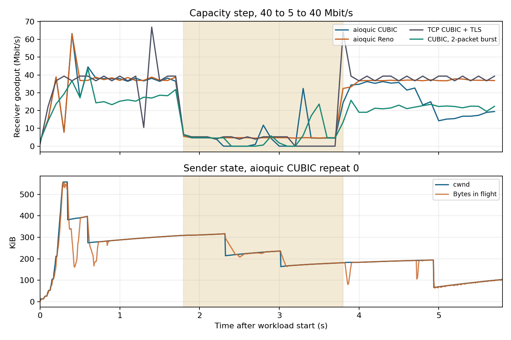
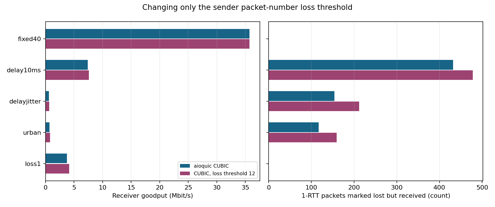
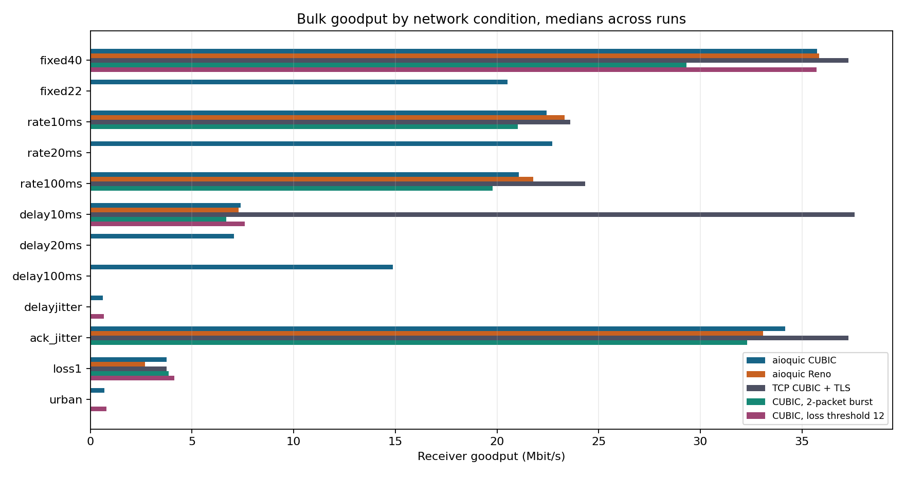
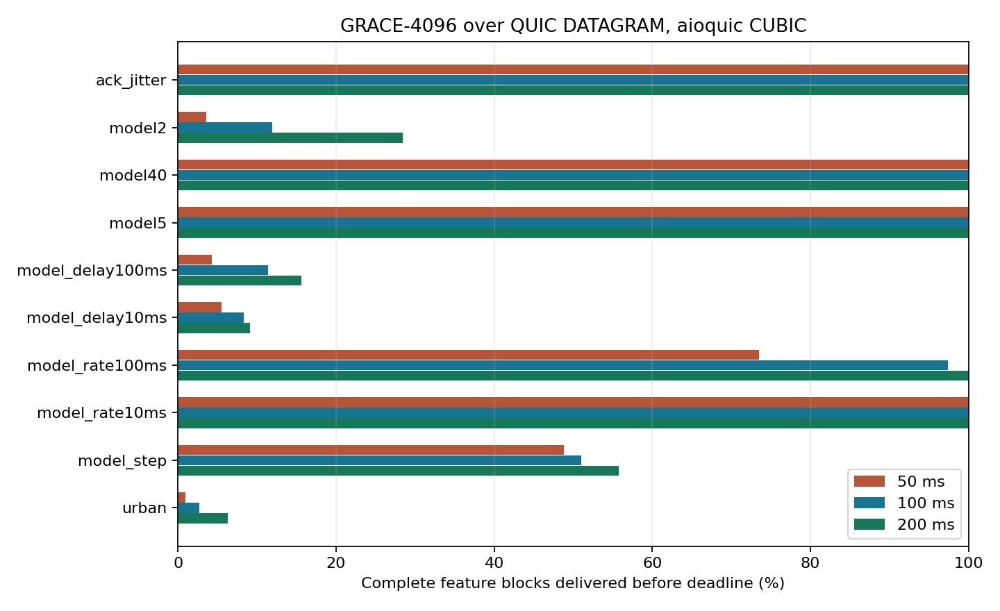

# 毫秒级网络波动下的 QUIC 窗口、pacing 与 GRACE 特征交付

正式矩阵包含 **222 轮**。147 轮持续流全部完成，75 轮模型实验中 66 轮完成 P 帧传输，9 轮在可靠控制阶段超时。共有 8,316 条帧次与截止时间评分，验证通过 222 对双侧抓包和 183 对双端 qlog。[验收清单](results/validation.json)

## 实验边界

实验在同一台 WSL2 主机上运行，数据和 ACK 都经过真实 veth，由中间路由命名空间执行上游 6G-Testbed 的 HTB/netem 规则。应用交付、QUIC 拥塞状态、收发抓包和路由队列统计分别采集。QUIC 使用 aioquic 1.2.0，TCP 参照使用同一条虚拟链路上的 Linux CUBIC + TLS 1.3。两种栈的用户态/内核实现、MSS 与 ACK 机制都有差异，跨协议差值描述本实验组合的表现。

持续流每轮 5.8 秒，计时从连接建立后开始。带宽和时延快速变化分别有 10、20、100 ms 驻留时间。另测长阶跃、队列大小、仅反向 ACK 抖动、注入随机丢包、轻微乱序和两项原版 Testbed 综合 profile。GRACE-4096 在 RTX 3070 上重新编码三个短片段，所得 P 帧特征经 QUIC DATAGRAM 传输，收端依照实际到达与块完整性用本地模型重建。模型计算与传输分开计时。完整方法见 [README](README.md)。

## 带宽波动主要表现为排队和窗口恢复代价

固定 40 Mbit/s、40 ms 基础 RTT 时，aioquic CUBIC 收端有效吞吐中位数为 **35.74 Mbit/s**，三轮范围 33.40–35.77。切到 5 Mbit/s 后的前 250 ms，窗口中位数仍为 **313 kB**，比切换前的 **300 kB** 略高。pacer 目标从 **39.03** 降到 **18.06 Mbit/s**，此时仍高于瓶颈 5 Mbit/s，直到低速最后 500 ms 才约为 **4.91 Mbit/s**。前向可匹配到达包的单向 P95 为 **311 ms**，队列丢包中位数为 **367**。

恢复 40 Mbit/s 后，随后约 2 秒收端平均 **25.86 Mbit/s**，低于同算法固定 40 场景去掉前 0.8 秒后的 **36.73 Mbit/s**，少交付约 **2.72 MB**。切回后短时跨过吞吐门槛包含积压释放，所以也报告整个恢复段的字节缺口。把队列从 256 缩到 96 包后，单向 P95 从 **311 降到 105 ms**，恢复段吞吐降到 **18.95 Mbit/s**。这是本场景的队列与利用率取舍。[逐轮恢复数据](results/recovery.csv)

快速交替带宽取切换区间的接收速率。固定 22.5 Mbit/s 的 CUBIC 对照在相同时段交付 **20.95 Mbit/s**，切换区间名义平均容量按实际 tc 提交时间加权。

| 40/5 Mbit/s 驻留 | CUBIC 有效吞吐 | 占名义容量 | 前向队列丢包 | 实际驻留间隔中位数 / 切换提交滞后 P95 |
|---|---:|---:|---:|---:|
| 10 ms | 19.99 Mbit/s | 88.7% | 197 | 10.00 / 2.45 ms |
| 20 ms | 20.24 Mbit/s | 90.7% | 200 | 19.99 / 2.86 ms |
| 100 ms | 17.58 Mbit/s | 79.8% | 216 | 100.02 / 3.56 ms |

在这组配置里，100 ms 驻留比 10 或 20 ms 更伤吞吐。只比较设定的平均速率会遗漏低速段积压、丢包和窗口对高低档的响应时间。

## 时延波动会让实际到达的包触发判丢

前向限速保持 40 Mbit/s，反向保持 20 ms，前向时延在 5 和 30 ms 切换，配置随机丢包为 0。

| 前向时延条件 | CUBIC 全窗 / 扰动时段有效吞吐 | 窗口中位数 | 判丢 / 收端实到同一包号 / 队列丢包 |
|---|---:|---:|---:|
| 固定 20 ms | 35.74 / 37.35 Mbit/s | 332 kB | 254 / 0 / 202 |
| 5/30 ms，每档 10 ms | 7.39 / 2.76 Mbit/s | 9.5 kB | 432 / 432 / 0 |
| 5/30 ms，每档 20 ms | 7.06 / 2.27 Mbit/s | 8.6 kB | 374 / 374 / 0 |
| 5/30 ms，每档 100 ms | 14.89 / 10.70 Mbit/s | 49.2 kB | 203 / 203 / 0 |
| 20 ms 加 5 ms 正态抖动 | 0.61 / 0.60 Mbit/s | 3.7 kB | 154 / 154 / 0 |

10 ms 驻留下，Reno 也只有 **7.30 Mbit/s** 全窗吞吐，TCP CUBIC + TLS 在同一仿真链路得到 **37.58 Mbit/s**。两种 QUIC 算法表现相近，且在有数据时频繁触及窗口限制。结合收端同一包号确实到达、链路队列无丢包以及发送端降窗的证据，现象符合时延差造成乱序、乱序触发早判丢、窗口收缩降低发送速率的链条。作为对照，单独注入 1% 随机丢包时，默认 CUBIC 的 22 个判丢中位数没有对应的原包到达。判丢阈值复验单独列出。

### 同均值时延对照与阈值复验

5/30 ms 的等占空比对应 **17.5 ms** 固定前向时延。这个对照全窗有效吞吐 **35.47 Mbit/s**，扰动对应时段 **37.25 Mbit/s**。时延均值相当，包时序不同，窗口和吞吐差距依然存在。

只把发送端包号判丢阈值从 **3 改为 12**，时间判丢阈值仍为 **9/8** 倍 RTT。三个重复的全窗有效吞吐中位数如下。

| 场景 | 阈值 3 | 阈值 12 | 阈值 3 / 12 判丢但收端实到的 1-RTT 包 |
|---|---:|---:|---:|
| 固定 40 Mbit/s | 35.74 | 35.70 | 0 / 0 |
| 5/30 ms，每档 10 ms | 7.39 | 7.60 | 432 / 478 |
| 20 ms 加 5 ms 正态抖动 | 0.61 | 0.66 | 154 / 212 |
| 上游 5g_urban | 0.69 | 0.80 | 117 / 159 |
| 1% 随机丢包 | 3.75 | 4.14 | 0 / 0 |

单位为 Mbit/s。扩大包号阈值没有恢复抖动场景的吞吐，误判到达包也仍大量存在。此复验只改变一个阈值，无法区分剩余误判中更深的乱序和时间阈值各占多少。[逐轮阈值数据](results/followup/runs.csv)

## ACK 抖动增加突发，较小的 pacing 桶有吞吐代价

前向链路相同，只在反向固定 30 ms 的基础上加 10 ms 正态抖动，CUBIC 的反向包间隔 P95 由 **1.58 增到 4.09 ms**，发送端每个有包的 1 ms 桶里大包数 P95 从 **7 增到 18**，前向队列丢包中位数从 **118 增到 213**。全窗 goodput **32.86 与 34.17 Mbit/s**，三轮范围重叠，未观察到平均吞吐随突发同步下降。

将发送端 pacer 的桶容量上限改为两个数据报所对应的时间，保持原速率公式和 CUBIC 算法。反向抖动条件下，发送突发 P95 由 **18 降到 8**，队列丢包中位数从 **213 降到 177**，吞吐从 **34.17 降到 32.30 Mbit/s**。固定 40 场景下，缩桶后前向单向 P95 从 **52.28 降到 33.35 ms**，吞吐从 **35.74 降到 29.31 Mbit/s**。两个版本的 pacing 回调迟到 P95 都约 **1 ms**。这个数量级大于 40 Mbit/s 时发送 1200 字节的约 0.24 ms，缩小桶之后，晚醒时可补发的包更少。这与观察到的延迟和吞吐取舍一致。

在固定 40 和 10 ms 容量切换各三轮中，关闭 qlog 后全窗 goodput 分别为 **36.27** 和 **23.34 Mbit/s**，打开时分别为 **35.74** 和 **22.45 Mbit/s**，相差约 1.5% 和 4.0%。两组仍保留内部 pacing 采样与 PCAP，定时器迟到 P95 都约 1 ms。这是日志开销的单独对照。[qlog 开关对照](results/no-qlog/transport_summary.csv)

## 本地模型验证

六个 GOP 的 42 张 P 帧合计 **522,185 字节** DEFLATE 特征，约 **2.61 Mbit/s** 源负载，按 30 fps 调度。数据报分片和网络协议头另计。下表采用原版 aioquic CUBIC，每种条件三轮、每个截止时间 126 个帧次。PSNR 为逐帧 dB 值的平均。

| 网络条件 | 50 ms 前完整块 | 100 ms 前完整块 | 200 ms 前完整块 | 100 ms 画质 |
|---|---:|---:|---:|---:|
| 固定 40 Mbit/s | 100% | 100% | 100% | 36.54 dB |
| 固定 5 Mbit/s | 100% | 100% | 100% | 36.54 dB |
| 固定 2 Mbit/s | 3.57% | 11.90% | 28.41% | 22.91 dB |
| 带宽 40/1 Mbit/s，每档 10 ms | 99.92% | 100% | 100% | 36.54 dB |
| 带宽 40/1 Mbit/s，每档 100 ms | 73.49% | 97.38% | 100% | 36.23 dB |
| 40→1→40 Mbit/s，中间低速 800 ms | 48.81% | 51.03% | 55.71% | 27.84 dB |
| 前向时延 5/80 ms，每档 10 ms | 5.56% | 8.33% | 9.13% | 22.28 dB |
| 前向时延 5/80 ms，每档 100 ms | 4.29% | 11.43% | 15.63% | 22.57 dB |
| 仅反向 ACK 抖动 | 100% | 100% | 100% | 36.54 dB |
| 上游 5g_urban | 0.95% | 2.70% | 6.27% | 21.57 dB |

同样的 40/1 Mbit/s 高低档，低速档短时可以等到高档补发，低速档达到 100 ms 时，平均带宽仍充足但 50 ms 截止交付已下降。时延抖动的退化在放宽到 200 ms 后仍存在。仅反向 ACK 抖动使持续流发包更集中，但这个约 2.61 Mbit/s 的模型负载仍能按时交付。

上游 congested 在 CUBIC、Reno 和缩小 pacer 桶的 CUBIC 中共 **9/9 次启动失败**。可靠 Stream 需先交付 68,503 字节控制数据及 81,546 字节 I 帧 JPEG，10 秒内没有完成确认，P 帧阶段没有开始。九轮保留在启动成功率分母内，PSNR 标为不可用。失败状态从当时的超时记录写回 Testbed SQLite，双侧 PCAP 仍在原始证据中。

预先交付控制数据、随后对 P 帧施加同一 congested profile，三轮均完成测试，但 **100 ms 内完整块仍为 0%，200 ms 内为 1.59%**。100 ms 的零块重建画质为 **20.84 dB**。这组额外复验的初次试跑有两轮在测量已结束后卡在 QUIC 关闭等待，限定了测量后的关闭等待并重跑三轮。初次三轮证据存于归档的 diagnostic-attempts，不计入上述正式分母。

固定前向 **42.5 ms** 对照与 5/80 ms 等占空比的均值相同，50 ms 内完整块仍为 **100%**，PSNR **36.54 dB**。10 ms 时延切换中把包号阈值改为 12，100 ms 完整块从 **8.33% 到 8.41%**，PSNR 约 **22.28 dB**，模型侧也没有观察到有效恢复。[模型复验数据](results/followup/grace_summary.csv)

## 如何判读

- **实际吞吐**采用收端应用在指定时间窗内交付的字节。链路可用速率、UDP/IP 字节数与应用 goodput 分别报告。
- **窗口压力**采用有待发数据且窗口信用不足一个数据报的采样比例。pacer 目标速率来自 1200 字节除以内部包间隔。实际出发包间隔和实际到达包间隔取自两处 PCAP。
- **判丢与实到**按连接的 1-RTT 包号关联发送端 qlog 的判丢事件和接收端 qlog 的到达事件。同一包号实到可以证明这个原包穿过链路，其中部分包可能在发送端判丢之前已经到达，但其确认尚未被发送端采用。重复传输的 STREAM 数据会使用新的 QUIC 包号。
- **真实队列丢包**读取前后 netem 叶子队列计数差。随机丢包 profile 的内核计数也包含该 profile 注入的丢失。对仅调时延的 profile，配置随机丢包为零。
- **应用截止交付**以源计划提交时刻加 50、100 或 200 ms 为判定。任何分片未及时到达，该块整块置零。每个截止时间来自同一轮网络接收事件。即使同样的丢包数，块内聚集方式与 GOP 内位置仍会改变 PSNR。

## 参考实现与标准

- [aioquic 1.2.0 丢包判定和 pacer](https://github.com/aiortc/aioquic/blob/1.2.0/src/aioquic/quic/recovery.py)
- [RFC 9002 包阈值、时间阈值与 pacing](https://www.rfc-editor.org/rfc/rfc9002.html#section-6.1)
- [RFC 9221 DATAGRAM 的拥塞控制](https://www.rfc-editor.org/rfc/rfc9221.html#section-5.4)

## 原始证据

可下载按实验轮次组织的 qlog、抓包、窗口与 pacing 事件、网络切换时刻、Testbed SQLite 及校验清单。模型权重、视频与特征源数据在本地生成与使用。[GitHub Release v1.0.0](https://github.com/qinyishcn/quic-testbed-lab/releases/tag/v1.0.0)
